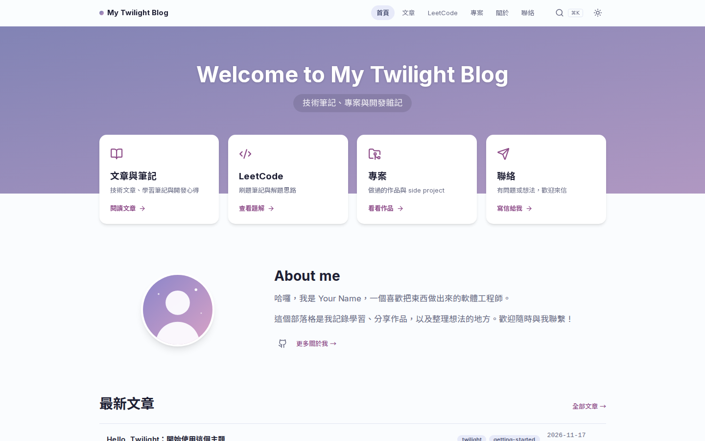
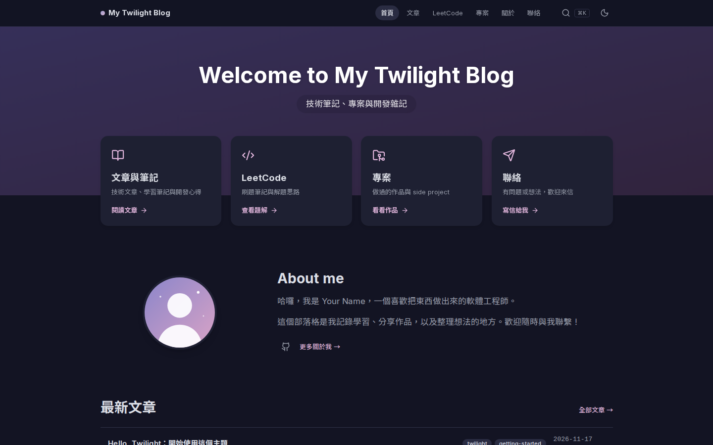

# Twilight — Next.js Blog Template

柔和的 Next.js 部落格主題「薄暮與星雲」：淺色模式是星雲般的淡紫與粉，深色模式是薄暮的靛藍。首頁有漸層 hero 和浮起的功能卡片，整體是大圓角、帶陰影的卡片風格。

*A soft lavender & nebula-pink blog theme for Next.js 15, with light and dark mode.*

| 淺色 | 深色 |
|---|---|
|  |  |

## 功能

- **淺色 / 深色模式**：預設跟隨系統，右上角可以切換，選擇會被記住，切換時不會閃爍
- **Markdown 寫文章**：frontmatter 由 Zod 檢查，格式錯誤會在 build 時就報錯
- **程式碼**：語法高亮、行號、複製按鈕
- **數學式**：KaTeX（`$行內$`、`$$區塊$$`）
- **提示框**：GitHub 風格的 `> [!NOTE]`、`[!TIP]`、`[!WARNING]`、`[!IMPORTANT]`、`[!CAUTION]`
- **系列文章**：frontmatter 填 `series`，同系列的文章會自動串起來
- **LeetCode 區**（選用）：`/leetcode` 題解列表，依難度和標籤篩選，在 `site.ts` 設 `showLeetCode: true` 打開
- **專案頁**：`/projects`，內容寫在 `_projects/*.md`
- **關於頁**：左右交錯的經歷時間軸、技能標籤、獲獎
- **版本紀錄**：`/changelog`
- **⌘K / Ctrl+K 搜尋**、**RSS**（`/feed.xml`）、**sitemap**、**每篇文章自動產生 OG 分享圖**
- **寫作熱度圖**（選用）：首頁顯示一年內的發文紀錄，在 `site.ts` 設 `showWritingActivity: true` 打開
- **Giscus 留言**（選用，會跟著深淺色切換）、**聯絡表單**（選用，用 Resend 寄信）

## 開始使用

在 GitHub 上按 **Use this template → Create a new repository**，或直接 clone：

```bash
git clone https://github.com/YuunJiee/blog-template-twilight.git my-blog
cd my-blog
npm install
npm run dev
```

打開 <http://localhost:3000>。

## 要改的檔案

| 檔案 | 內容 |
|---|---|
| `src/config/site.ts` | 網站名稱、網址、作者、首頁自我介紹、LeetCode 區和寫作熱度圖的開關、Giscus |
| `src/data/about.ts` | 關於頁：經歷、技能、獲獎 |
| `public/images/avatar.svg` | 大頭貼。換成 png 的話，記得同時改 `site.ts` 的 `author.avatar` |
| `src/app/icon.svg` | 網站圖示 |
| `_posts/` | 文章（範例文章可以直接刪掉） |
| `_projects/` | 專案 |
| `_changelog/` | 版本紀錄 |

### 換顏色

所有顏色都在 `src/app/globals.css` 開頭：`:root` 是淺色模式，`.dark` 是深色模式。主要改這幾個就好：

| 變數 | 用途 |
|---|---|
| `--primary` | 薄暮紫：目前頁面、時間軸、按鈕 |
| `--accent` | 星雲粉：卡片邊框、標記點等裝飾 |
| `--link` | 連結和文章小標題的顏色（比 `--accent` 深，確保在白底上看得清楚） |
| `--hero-from` / `--hero-to` | 首頁漸層的兩端 |

### 新增文章

```bash
cp _templates/blog-post.md _posts/my-post.md       # 一般文章
cp _templates/leetcode-post.md _posts/lc-1.md      # LeetCode 題解（記得打開 showLeetCode）
```

`draft: true` 的文章在正式環境不會出現。

### 留言（選用）

到 <https://giscus.app> 取得設定值，填進 `site.ts` 的 `giscus`。保持 `null` 就不會顯示留言區。

### 聯絡表單（選用）

複製 `.env.example` 成 `.env.local`，填入 [Resend](https://resend.com) 的 API key 和收件信箱。沒設定的話，表單會顯示「尚未設定」，不會報錯。

## 部署

**Vercel**：匯入這個 repo，設定環境變數 `NEXT_PUBLIC_SITE_URL`（你的網址，結尾不要加 `/`）即可。

**Docker**：

```bash
docker build -t twilight-blog --build-arg NEXT_PUBLIC_SITE_URL=https://your-domain.com .
docker compose up -d
```

## 技術

Next.js 15（App Router）· React 19 · TypeScript · Tailwind CSS v4 · remark / rehype · Zod

字體：[Inter](https://fonts.google.com/specimen/Inter)、[Noto Sans TC](https://fonts.google.com/noto/specimen/Noto+Sans+TC)，皆為 SIL Open Font License。

## 授權

MIT
